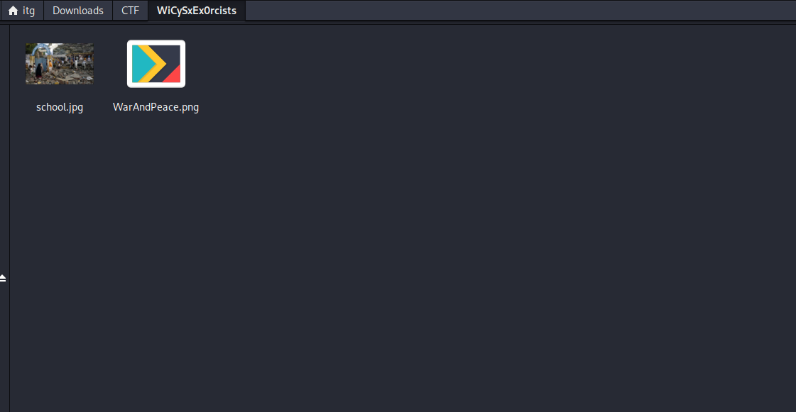
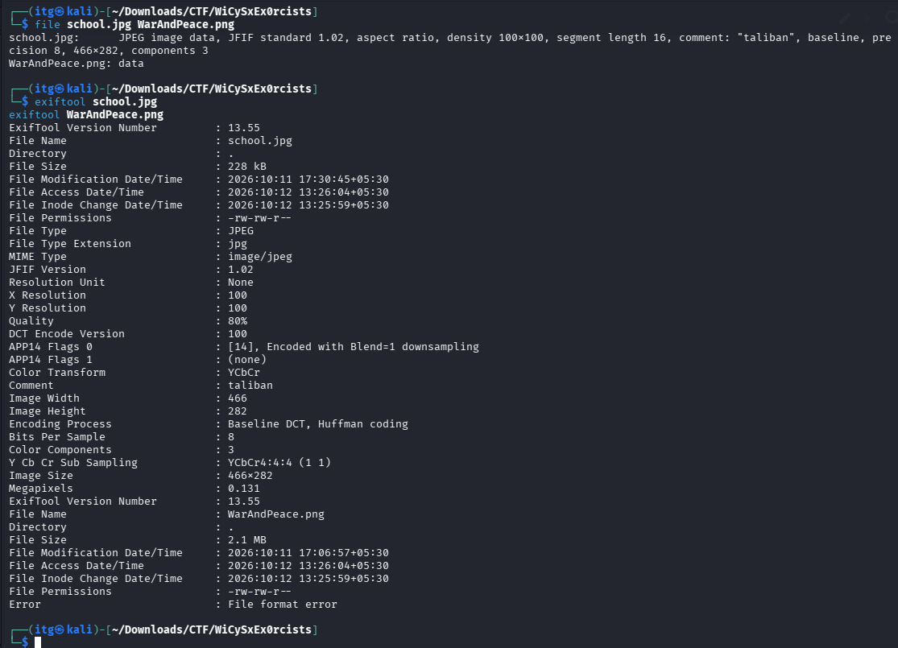
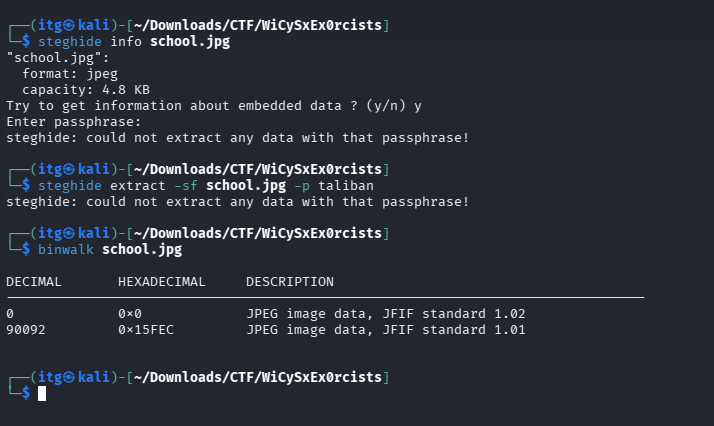
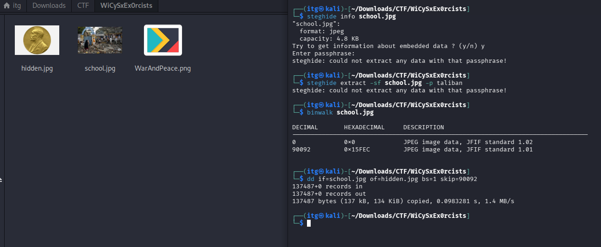
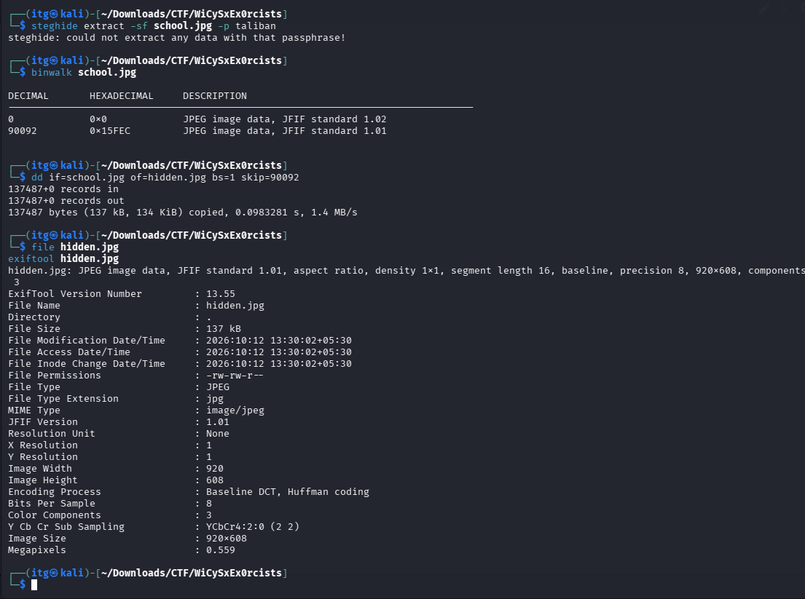
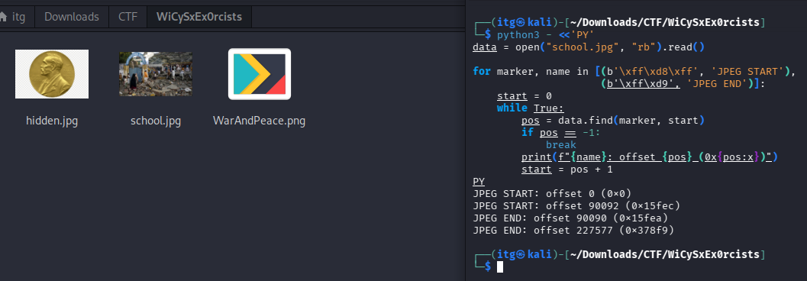
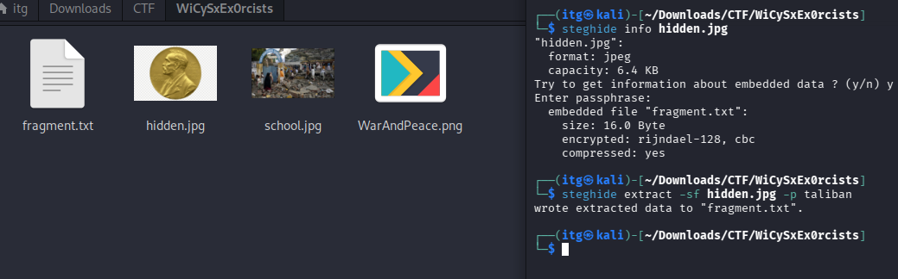
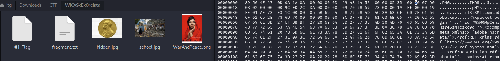

# A Picture Is Worth Two Fragments 🚩

## Challenge Information

| Detail | Information |
|---|---|
| Event | WiCySxEx0rcists 2026 |
| Category | Forensics |
| Points | 500 |
| Difficulty | Medium |
| Challenge Author | KULL4N4R1 |
| Files | `school.jpg`, `WarAndPeace.png` |
| Flag Format | `WiCySxEx0rcists{...}` |

---

## Challenge Description

> Two files, two fragments, one hidden truth. Looks can be deceiving, and the clues are hiding in places most people overlook.
>
> Can you uncover both fragments and piece together the flag?

In this challenge, I was given two image files, `school.jpg` and `WarAndPeace.png`. The description suggested that both files contained hidden fragments of the flag.

My objective was to investigate the images, recover both fragments, and combine them to reconstruct the complete flag.

## Initial Analysis

I started by examining the provided files in Kali Linux.



I used `file` and `exiftool` to identify the file formats and inspect their metadata.

```bash
file school.jpg WarAndPeace.png
exiftool school.jpg
exiftool WarAndPeace.png
```

The initial analysis revealed two interesting findings:

- `school.jpg` was recognized as a valid JPEG and contained an unusual comment: `taliban`.
- `WarAndPeace.png` returned a file-format error.



These findings suggested that the JPEG might contain password-protected information, while the PNG might have been modified.

---

## Solution

### Part 1 — Recovering the First Fragment from school.jpg

#### Step 1: Investigating the Metadata

While examining `school.jpg`, I noticed an unusual comment in its metadata.

```text
Comment : taliban
```

I suspected that `taliban` could be a passphrase for hidden information.

Since the file was a JPEG, I decided to try Steghide.

```bash
steghide info school.jpg
steghide extract -sf school.jpg -p taliban
```

However, the extraction failed.

```text
steghide: could not extract any data with that passphrase!
```

The password didn't work on the original image, so I decided to investigate its file structure instead.

#### Step 2: Discovering a Hidden JPEG

I scanned the image using Binwalk.

```bash
binwalk school.jpg
```

Output:

```text
DECIMAL       HEXADECIMAL    DESCRIPTION
0             0x0           JPEG image data
90092         0x15FEC       JPEG image data
```

Binwalk detected two JPEG signatures inside the same file.

The first image started at offset `0`, while the second started at offset `90092`.

This was interesting because it suggested that another JPEG image had been appended to `school.jpg`.



#### Step 3: Extracting the Hidden JPEG

To extract the second image, I used the `dd` command with the offset found using Binwalk.

```bash
dd if=school.jpg of=hidden.jpg bs=1 skip=90092
```

This created a new image called `hidden.jpg`.



I verified the extracted file using:

```bash
file hidden.jpg
exiftool hidden.jpg
```

The output confirmed that it was a valid JPEG image with dimensions of 920 × 608.



To confirm that two images had actually been joined together, I also checked the JPEG start and end markers using Python. I created a dedicated forensics script that searches for JPEG start and end markers to help identify concatenated JPEG images:

- [View Python Forensics Script](scripts/inspect_jpeg.py)

Usage example:

```bash
python3 scripts/inspect_jpeg.py school.jpg
```

Verification script logic:

```python
data = open("school.jpg", "rb").read()

for marker, name in [
    (b'\xff\xd8\xff', 'JPEG START'),
    (b'\xff\xd9', 'JPEG END')
]:
    start = 0

    while True:
        pos = data.find(marker, start)

        if pos == -1:
            break

        print(f"{name}: offset {pos} (0x{pos:x})")
        start = pos + 1
```

Output:

```text
JPEG START: offset 0 (0x0)
JPEG START: offset 90092 (0x15fec)
JPEG END: offset 90090 (0x15fea)
JPEG END: offset 227577 (0x378f9)
```

The first JPEG ended immediately before the second began, confirming that two JPEG images had been concatenated.



#### Step 4: Extracting the First Flag Fragment

After extracting `hidden.jpg`, I decided to try Steghide again.

```bash
steghide info hidden.jpg
```

When prompted for a passphrase, I entered `taliban`, which I had discovered in the original image's metadata.

This time, Steghide revealed an embedded file.

```text
embedded file "fragment.txt":
    size: 16.0 Byte
    encrypted: rijndael-128, cbc
    compressed: yes
```

I then extracted it using:

```bash
steghide extract -sf hidden.jpg -p taliban
```

Output:

```text
wrote extracted data to "fragment.txt".
```

Finally, I opened the extracted text file.

```bash
cat fragment.txt
```

Output:

```text
WiCySxEx0rcists{
```

I had successfully recovered the **first fragment of the flag**.



---

### Part 2 — Recovering the Second Fragment from WarAndPeace.png

#### Step 1: Investigating the PNG File

Next, I moved on to the second image, `WarAndPeace.png`.

I started by checking its metadata.

```bash
exiftool WarAndPeace.png
```

But ExifTool returned an error.

```text
Error : File format error
```

To investigate further, I checked its file type and examined the first few bytes.

```bash
file WarAndPeace.png
xxd -l 64 WarAndPeace.png
```

The file was identified as generic data instead of a valid PNG.

#### Step 2: Identifying the Corrupted PNG Header

A valid PNG file must begin with the following signature:

```text
89 50 4E 47 0D 0A 1A 0A
```

However, our file began with:

```text
00 50 4E 47 0D 0A 1A 0A
```

I noticed that the first byte was `00` instead of `89`.

This single incorrect byte was preventing the image from opening normally.

#### Step 3: Repairing the PNG Using Hexedit

To fix the image, I opened it using Hexedit.

```bash
hexedit WarAndPeace.png
```

Inside the hex editor, I manually changed the first byte from `00` to `89`.

After making the change, I pressed `F2` to save and `Ctrl + X` to exit.



I then opened the repaired image.

```bash
xdg-open WarAndPeace.png
```

This time, the image opened successfully.

It displayed a portrait against a red background, and I noticed some white text near the bottom-right corner.

```text
truth_survives_erasure}
```

This was the **second fragment of the flag**.


---

### Part 3 — Reconstructing the Flag

After investigating both images, I had successfully recovered the two fragments.

**First Fragment — school.jpg**

```text
WiCySxEx0rcists{
```

**Second Fragment — WarAndPeace.png**

```text
truth_survives_erasure}
```

Combining the fragments gave me the complete flag.

## Final Flag 🚩

```text
WiCySxEx0rcists{truth_survives_erasure}
```

---

## Tools Used

| Tool | Purpose |
|---|---|
| `file` | Identify file types |
| `exiftool` | Inspect image metadata |
| `binwalk` | Discover the hidden JPEG |
| `dd` | Extract the appended JPEG |
| `steghide` | Extract the password-protected text file |
| `xxd` | Inspect the PNG signature |
| `hexedit` | Repair the corrupted PNG header |
| Python 3 | Verify JPEG start and end offsets |

---

## Key Takeaways

This challenge helped me understand how multiple forensic techniques can be combined to hide information inside ordinary-looking images.

The first image required metadata analysis, file carving, and steganography extraction. Finding the password wasn't enough; I also had to discover that a second JPEG had been appended to the original image.

The second image required a different approach. By inspecting its hexadecimal signature, I discovered that a single byte was preventing the PNG from opening. Once I corrected the header using Hexedit, the second fragment became visible.

The biggest lesson I learned was that **a file's visible contents aren't always the whole story**. Metadata, embedded files, and even a single modified byte can reveal important information.

---

**Flag:** `WiCySxEx0rcists{truth_survives_erasure}`

*Thanks for reading!*
