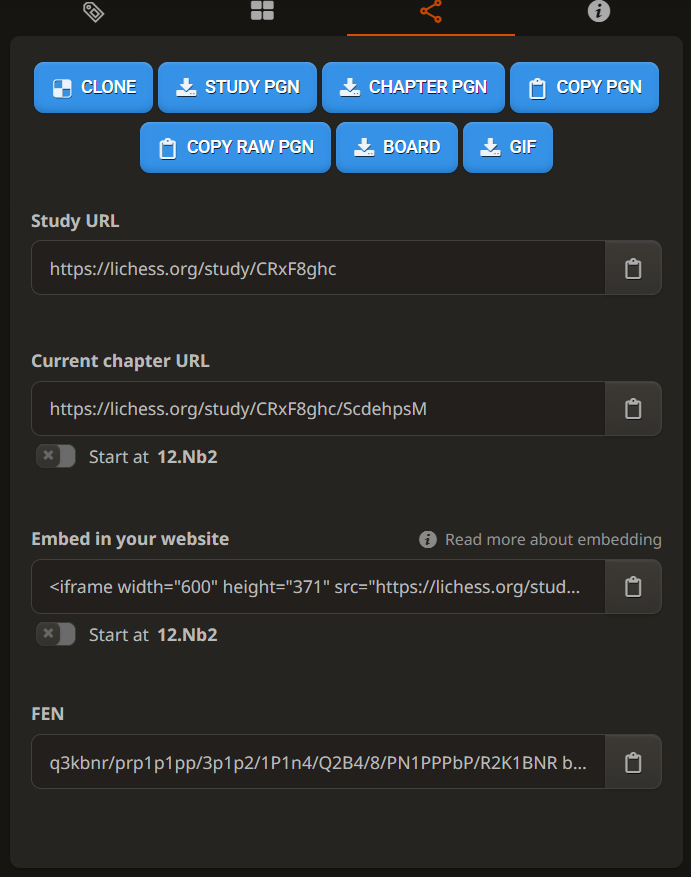
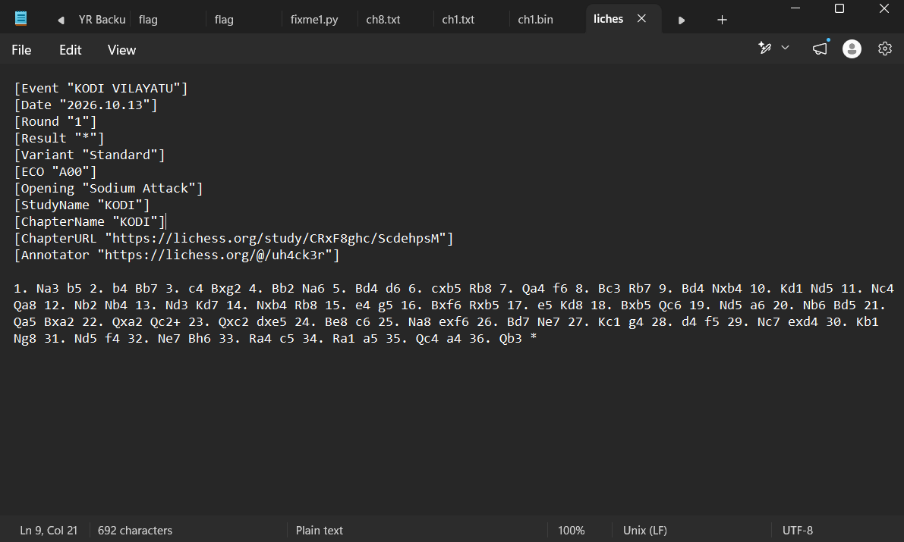
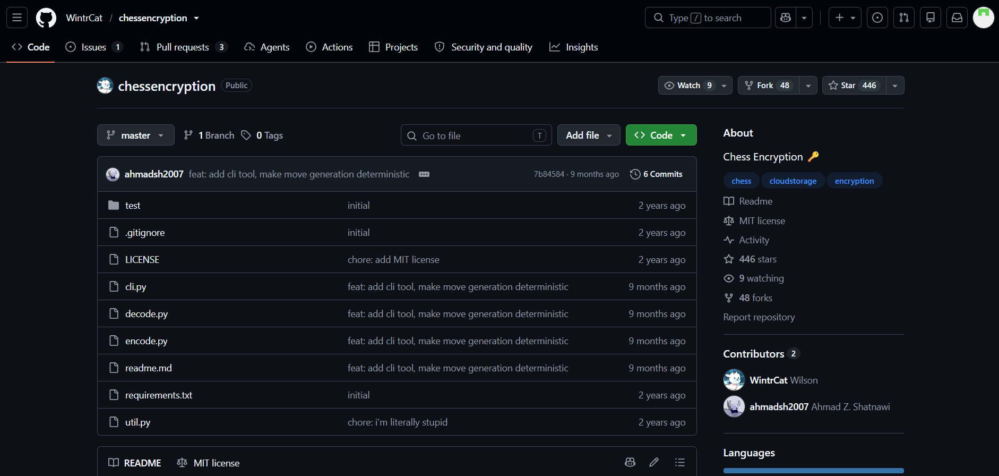
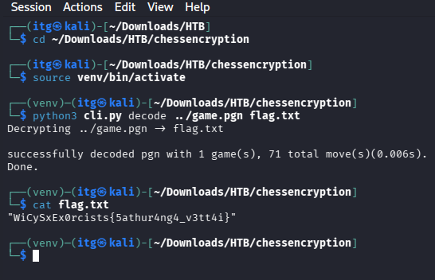

# Day 02 — KODI VILAYATU 🚩

## Challenge Overview

| Detail | Information |
|---|---|
| **Event** | WiCyS × Ex0rcists 2026 |
| **Challenge** | Day 02 — KODI VILAYATU |
| **Category** | Miscellaneous |
| **Difficulty** | Medium |
| **Techniques** | OSINT + Chess Steganography |
| **Lichess Study** | [KODI Study](https://lichess.org/study/CRxF8ghc) |
| **Lichess Chapter** | [KODI Chapter](https://lichess.org/study/CRxF8ghc/ScdehpsM) |
| **Decoding Tool** | [WintrCat/chessencryption](https://github.com/WintrCat/chessencryption) |
| **Files Provided** | `game.pgn` (Exported from Lichess) |
| **Flag Format** | `WiCySxEx0rcists{...}` |
| **Status** | Solved ✅ |

---

## Challenge Description

The Day 02 challenge was released under the **Miscellaneous** category with the following prompt:

> Can you Connect the dots, Hunt for clues, Explore the digital trail, Search for the study, and Solve the mystery left by one of the challenge authors, who has been engrossed in a serious study on a royal battlefield game?

**Flag Format:** `WiCySxEx0rcists{...}`

---

## Official Hints

During the competition, three progressive hints were provided to guide participants:

- **Level 1:** *Hidden in plain sight.*
- **Level 2:** *Understand the question and pin down the platform with the given clues.*
- **Level 3:** *With the right tool and right weapon, we can win the flag!*

### How the Hints Guided the Investigation

1. **Level 1 ("Hidden in plain sight"):** Directed attention immediately to the wording of the prompt itself. The capitalization of the action verbs was intentional and contained the primary clue right at the surface.
2. **Level 2 ("Pin down the platform"):** Connected the keywords *"study"* and *"royal battlefield game"* to identify the target web platform. Chess is universally referred to as the royal battlefield game, and **Lichess** features a dedicated feature called **Studies** where players publish analyses.
3. **Level 3 ("With the right tool"):** Indicated that standard steganographic utilities (`steghide`, `zsteg`, `binwalk`) would be ineffective. The game moves required a specialized chess steganography decoding tool.

---

## Initial Investigation

### Hidden CHESS Acrostic

Reading the first word of each clause in the challenge description revealed a classic acrostic cipher:

| Action Word | First Letter |
|---|:---:|
| **C**onnect | **C** |
| **H**unt | **H** |
| **E**xplore | **E** |
| **S**earch | **S** |
| **S**olve | **S** |

Combining these letters spelled out **CHESS**.

Reinforcing this conclusion:
- **"royal battlefield game"**: Chess represents an ancient battlefield simulation featuring kings, queens, knights, bishops, rooks, and pawns.
- **"Search for the study"**: Points specifically to the chess platform **Lichess**, which hosts user-created collaborative collections called **Lichess Studies**.
- **"KODI VILAYATU"**: In Tamil, *Kodi* translates to "Flag" and *Vilayatu* translates to "Play" or "Game" — literally hinting at a "Flag Game" or "Capture The Flag Chess Game".

---

## Discovering the Lichess Study

Guided by the acrostic and clues, I searched Lichess for studies matching the challenge title `KODI` or created by the competition organizers.

The investigation led directly to the public study:
- **Study URL:** [https://lichess.org/study/CRxF8ghc](https://lichess.org/study/CRxF8ghc)
- **Chapter URL:** [https://lichess.org/study/CRxF8ghc/ScdehpsM](https://lichess.org/study/CRxF8ghc/ScdehpsM)
- **Study Name:** `KODI`
- **Annotator / Author:** `uh4ck3r` (`https://lichess.org/@/uh4ck3r`)

The study contained a recorded game with 36 moves that displayed unusual opening and tactical choices (such as the Sodium Attack `1. Na3 b5`).


*Figure 1: The KODI chess study discovered on Lichess.*

Lichess allows users to view, share, and export studies in standard **PGN (Portable Game Notation)** format via the *Share & Export* panel shown in Figure 1.

---

## Extracting the PGN

I exported the raw PGN data directly from the Lichess study chapter. The recorded metadata and full sequence of moves were as follows:

```pgn
[Event "KODI VILAYATU"]
[Date "2026.10.13"]
[Round "1"]
[Result "*"]
[Variant "Standard"]
[ECO "A00"]
[Opening "Sodium Attack"]
[StudyName "KODI"]
[ChapterName "KODI"]
[ChapterURL "https://lichess.org/study/CRxF8ghc/ScdehpsM"]
[Annotator "https://lichess.org/@/uh4ck3r"]

1. Na3 b5 2. b4 Bb7 3. c4 Bxg2 4. Bb2 Na6 5. Bd4 d6 6. cxb5 Rb8 7. Qa4 f6 8. Bc3 Rb7 9. Bd4 Nxb4 10. Kd1 Nd5 11. Nc4 Qa8 12. Nb2 Nb4 13. Nd3 Kd7 14. Nxb4 Rb8 15. e4 g5 16. Bxf6 Rxb5 17. e5 Kd8 18. Bxb5 Qc6 19. Nd5 a6 20. Nb6 Bd5 21. Qa5 Bxa2 22. Qxa2 Qc2+ 23. Qxc2 dxe5 24. Be8 c6 25. Na8 exf6 26. Bd7 Ne7 27. Kc1 g4 28. d4 f5 29. Nc7 exd4 30. Kb1 Ng8 31. Nd5 f4 32. Ne7 Bh6 33. Ra4 c5 34. Ra1 a5 35. Qc4 a4 36. Qb3 *
```

The exported game consists of **71 half-moves** (ply), ending on White's 36th move (`36. Qb3 *`).

I saved this authentic notation directly to [`game.pgn`](./game.pgn) in the challenge directory.


*Figure 2: Original PGN file containing the KODI VILAYATU game and metadata.*

---

## Chess Steganography Explained

Rather than being played for competitive tactical advantage, the moves in `game.pgn` act as a data transport layer. This technique is known as **Chess Steganography**.

### The Encoding Algorithm

In any given board state, the current player has a discrete set of legal moves. By establishing a deterministic ordering for these legal moves, arbitrary binary data can be embedded:

1. **Board State Initialization:** Start with the standard chess board layout (FEN: `rnbqkbnr/pppppppp/8/8/8/8/PPPPPPPP/RNBQKBNR w KQkq - 0 1`).
2. **Legal Move Enumeration:** Generate all valid, legal moves available to the active player according to the rules of chess.
3. **UCI Coordinate Formatting:** Express every legal move in **Universal Chess Interface (UCI)** format (e.g., `b1a3`, `e2e4`, `g1f3`).
4. **Lexicographical Sorting:** Sort the UCI strings alphabetically.
5. **Move Indexing:** Locate the index $i$ of the move that was actually played (0-indexed).
6. **Bit Capacity Calculation:** If there are $N$ legal choices, the move can reliably encode $k = \lfloor\log_2(N)\rfloor$ bits without ambiguity.
7. **Binary Conversion:** Convert the index $i$ into a $k$-bit binary string, preserving any leading zeros.
8. **Board Advance:** Apply the played move to update the board state.
9. **Iteration:** Repeat steps 2 through 8 for every subsequent move.
10. **Reconstruction:** Concatenate all extracted bits and pack them into 8-bit bytes to recover ASCII text.

### Step-by-Step Educational Example

Let us trace the first four half-moves of `game.pgn`:

#### Move 1 (White): `1. Na3`
- Current position has $N = 20$ legal opening moves ($\lfloor\log_2(20)\rfloor = 4$ bits).
- Sorted UCI moves start: `[a2a3 (0), a2a4 (1), b1a3 (2), b1c3 (3), c2c3 (4), ...]`.
- The played move is `Na3` (`b1a3`), which corresponds to sorted index `2`.
- Binary representation (4 bits): `0010`.

#### Move 1 (Black): `1... b5`
- Black also has $N = 20$ legal opening responses ($4$ bits).
- Sorted UCI moves start: `[a7a6 (0), a7a5 (1), b7b5 (2), b7b6 (3), ...]`.
- The played move is `b5` (`b7b5`), which corresponds to sorted index `2`.
- Binary representation (4 bits): `0010`.

**Combining Move 1 (White + Black):**
$$\text{Bits: } 00100010_2 = 0\text{x}22 = 34_{10} \implies \text{ASCII } \mathbf{"}$$

#### Move 2 (White): `2. b4`
- White plays `b4` (`b2b4`), mapping to sorted index `5`.
- Binary representation (4 bits): `0101`.

#### Move 2 (Black): `2... Bb7`
- Black plays `Bb7` (`c8b7`), mapping to sorted index `7`.
- Binary representation (4 bits): `0111`.

**Combining Move 2 (White + Black):**
$$\text{Bits: } 01010111_2 = 0\text{x}57 = 87_{10} \implies \text{ASCII } \mathbf{W}$$

This explains why the decoded output in terminal begins with a quotation mark followed by `W`: `"WiCySxEx0rcists{...}"`.

---

## Finding WintrCat's Decoder

Researching implementations of this exact UCI-sorted move-index algorithm led to the open-source repository **`WintrCat/chessencryption`** by security researcher and developer **WintrCat**:

- **Repository:** [https://github.com/WintrCat/chessencryption](https://github.com/WintrCat/chessencryption)
- **Description:** A Python-based CLI tool and web application for encoding and decoding files and text into chess PGNs using legal move indexing.


*Figure 3: WintrCat's chess encryption repository used for decoding.*

The tool handles legal move generation via `python-chess`, calculates bit lengths per turn, manages terminal byte padding, and writes the decoded bytes directly to an output file.

---

## Setting Up the Decoder

On my Kali Linux workstation, I set up an isolated Python environment and cloned the decoder:

```bash
# Clone the repository
git clone https://github.com/WintrCat/chessencryption.git
cd chessencryption

# Create and activate a dedicated virtual environment
python3 -m venv venv
source venv/bin/activate

# Install required dependencies (python-chess, click, etc.)
pip install -r requirements.txt
```

---

## Decoding the Hidden Message

With the environment prepared, I navigated to the directory containing the cloned tool, referenced the exported [`game.pgn`](./game.pgn) located in the parent directory, and ran the decoding command:

```bash
cd ~/Downloads/HTB/chessencryption
source venv/bin/activate
python3 cli.py decode ../game.pgn flag.txt
cat flag.txt
```

### Verified Terminal Output

```text
Decrypting ../game.pgn → flag.txt
successfully decoded pgn with 1 game(s), 71 total move(s)(0.006s).
Done.
```

Reading `flag.txt` revealed the plaintext flag:

```text
"WiCySxEx0rcists{5athur4ng4_v3tt4i}"
```


*Figure 4: Successfully decoding the PGN and recovering the challenge flag.*

The tool completed decoding across all 71 recorded half-moves in 0.006 seconds, recovering the complete flag without errors or missing characters.

---

## Flag Recovery

$$\mathbf{WiCySxEx0rcists\{5athur4ng4\_v3tt4i\}}$$

### Linguistic and Thematic Context

The leetspeak flag string `5athur4ng4_v3tt4i` transliterates to **Sathuranga Vettai**:
- **Sathurangam (சதுரங்கம்):** The classical Tamil name for the game of Chess (derived from the ancient Indian strategy game *Chaturanga*).
- **Vettai (வேட்டை):** The Tamil word for "Hunt".

Combined, **Sathuranga Vettai** means **"Chess Hunt"**, tying together:
1. The Tamil challenge title **KODI VILAYATU** (*Flag Game*).
2. The hunt through the Lichess study.
3. The extraction of hidden flag data from the sequence of chess moves.

---

## Key Takeaways

1. **Multidisciplinary CTF Synthesis:** This challenge blended OSINT (identifying the platform and tracking down author studies) with non-traditional steganography (encoding information in deterministic game-state branches).
2. **Careful Linguistic Reconnaissance:** The description provided critical clues through capitalization (the `CHESS` acrostic) and specific terminology (*"study"*, *"royal battlefield game"*).
3. **State-Dependent Sensitivity in Steganography:** In move-index steganography, every move's legal choices depend strictly on the board position resulting from all prior moves. Missing or altering even a single half-move invalidates the entire subsequent bitstream.
4. **Leveraging Existing Research:** Rather than reinventing the wheel with an ad-hoc solver script, identifying the author's reference algorithm and utilizing the authoritative open-source implementation ([WintrCat/chessencryption](https://github.com/WintrCat/chessencryption)) ensured 100% fidelity.

---

## References

- [KODI Lichess Study](https://lichess.org/study/CRxF8ghc)
- [KODI Lichess Study Chapter](https://lichess.org/study/CRxF8ghc/ScdehpsM)
- [WintrCat/chessencryption GitHub Repository](https://github.com/WintrCat/chessencryption)
- [WiCySxEx0rcists 2026 CTF Writeups Archive](https://github.com/yuvanr-design/CTF-Writeups)
