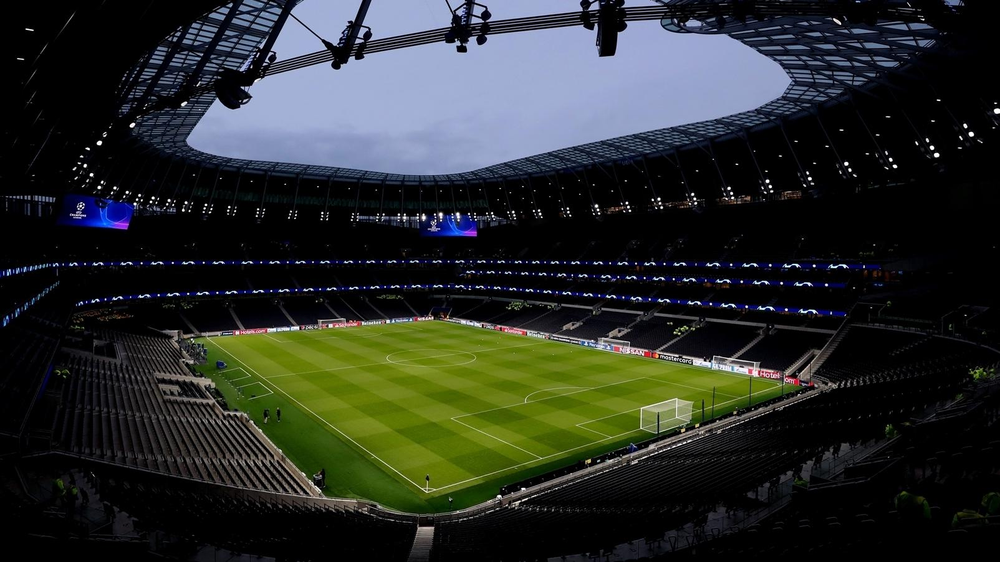
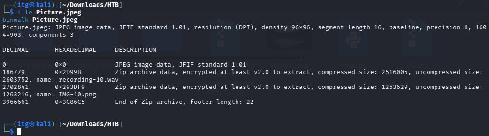
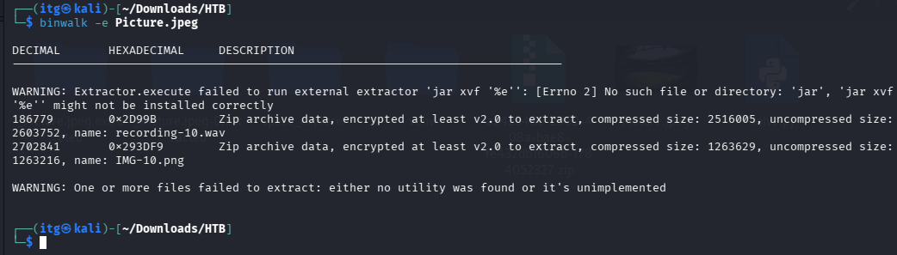
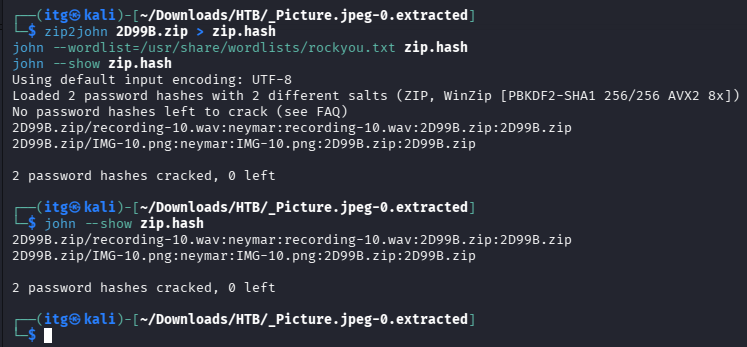
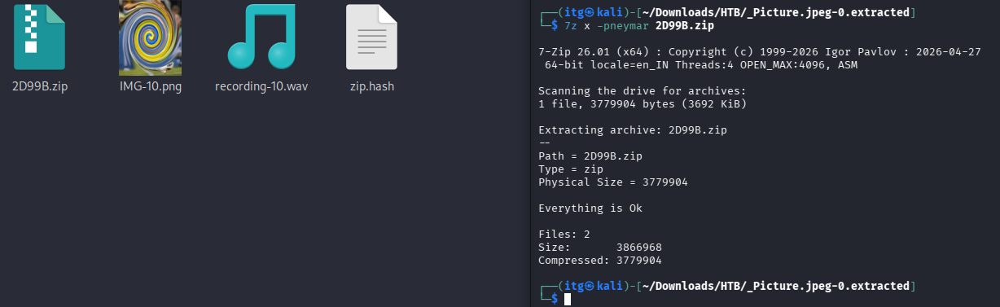
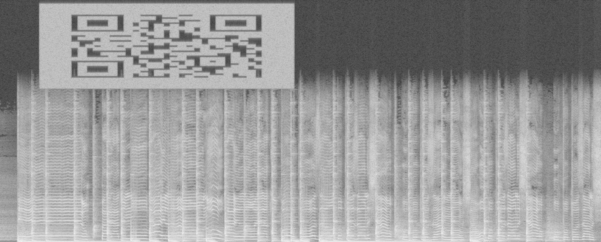
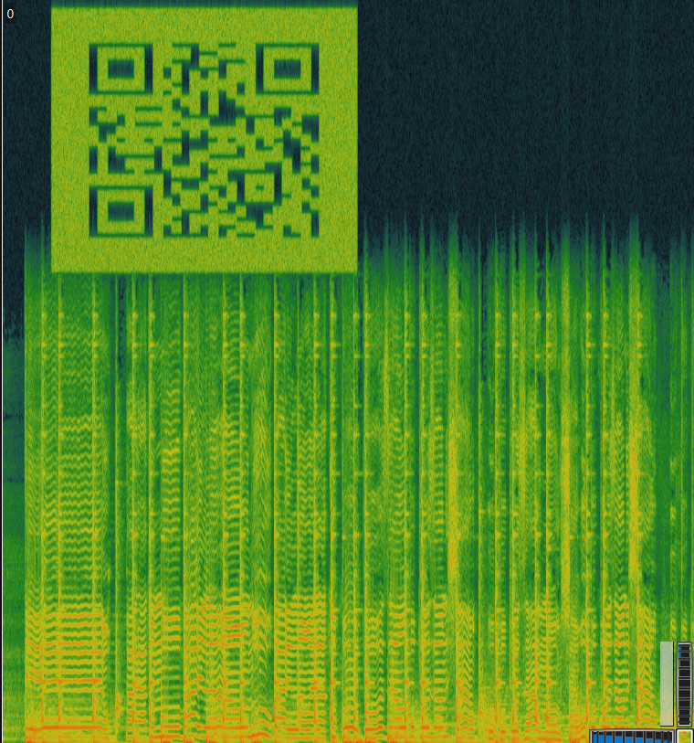
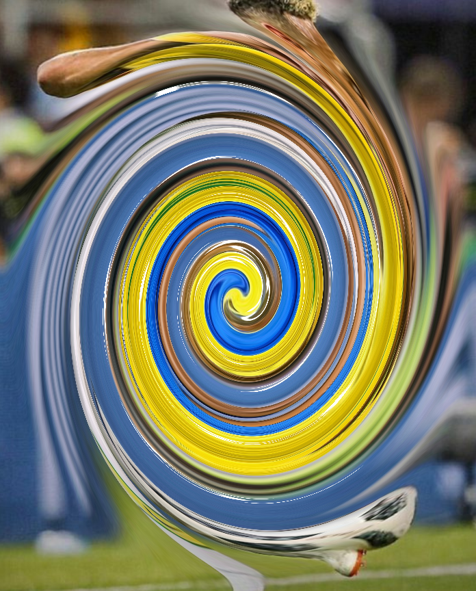
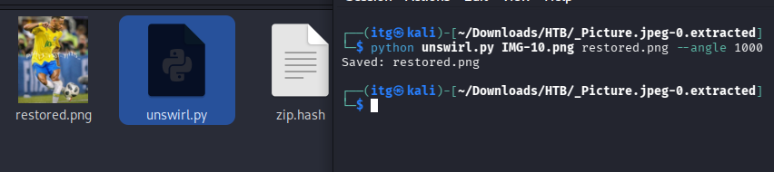
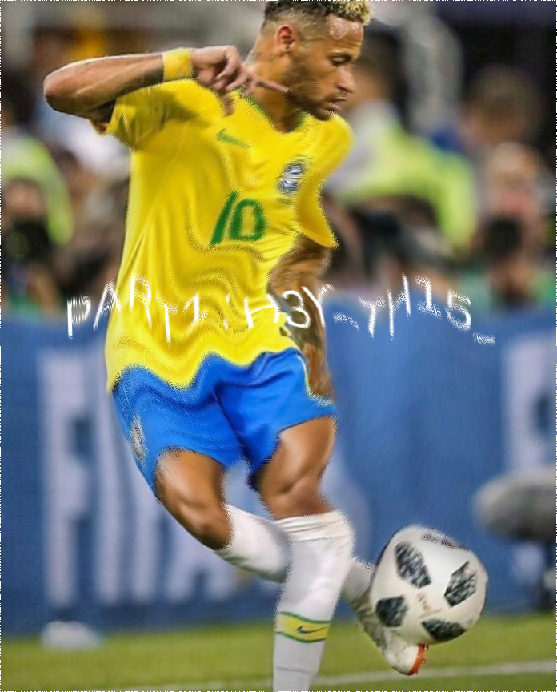

# Day 05 — The Prince Who Never Became The King 🚩

## Challenge Overview

| Detail | Information |
|---|---|
| **Event** | WiCyS × Ex0rcists 2026 |
| **Challenge** | Day 05 — The Prince Who Never Became The King |
| **Category** | Miscellaneous |
| **Author** | sh4d0wkh4n |
| **Initial Attachment** | `Picture.jpeg` |
| **Extracted Archive** | Embedded ZIP (AES-encrypted) |
| **Extracted Files** | `IMG-10.png`, `recording-10.wav` |
| **Recovered Password** | `neymar` |
| **Cracking Tools** | `zip2john`, `john` (John the Ripper) |
| **Flag Format** | `WiCySxEx0rcists{...}` |
| **Status** | Solved ✅ |

---

## Challenge Description

The Day 05 challenge was released under the **Miscellaneous** category with the title **"The Prince Who Never Became The King"**, authored by **sh4d0wkh4n**, and provided an attachment named `Picture.jpeg`.


*Figure 1: Official challenge description and attachment prompt.*

In international football culture, Brazilian forward **Neymar Jr.** is famously characterized as *"The Prince Who Never Became The King"*—an immensely gifted heir to Brazilian legends Pelé, Ronaldo, and Ronaldinho, who achieved massive club success but never lifted the FIFA World Cup or claimed a Ballon d'Or. This cultural clue proved central during password recovery.

**Flag Format:** `WiCySxEx0rcists{...}`

---

## Solution Walkthrough

### 1. Initial Inspection

I began by inspecting the provided attachment `Picture.jpeg` using standard file identification and firmware analysis tools on Kali Linux:

```bash
file Picture.jpeg
binwalk Picture.jpeg
```


*Figure 2: Inspecting Picture.jpeg with file and scanning embedded headers with binwalk.*

The `file` command identified `Picture.jpeg` as standard JPEG image data. However, running `binwalk` revealed a secondary signature embedded within the file:

- The initial JPEG stream starts at offset `0`.
- The JPEG concludes with the standard **End of Image (EOI)** marker (`FF D9`) at decimal offset **186777**.
- Immediately following at decimal offset **186779**, a valid **ZIP header** (`50 4B 03 04` / `PK\x03\x04`) is detected.

This indicated that a ZIP archive had been appended directly to the end of the stadium JPEG.

---

### 2. Archive Extraction

To carve the embedded archive from `Picture.jpeg`, I used `binwalk`:

```bash
binwalk -e Picture.jpeg
```


*Figure 3: Extracting the appended ZIP archive using binwalk.*

*(Note: Depending on the specific version of binwalk and environment configurations, the extracted directory and file naming conventions may vary. The archive can also be reproduced using standard carving utilities like `dd if=Picture.jpeg of=hidden.zip bs=1 skip=186779`.)*

---

### 3. Password Recovery with John the Ripper

Attempting to inspect or decompress the carved archive indicated that its contents were protected by AES archive encryption. To recover the password, I utilized **John the Ripper** and its accompanying archive preprocessor **`zip2john`**:

1. **Hash Extraction:** `zip2john` parses the archive's central directory and encryption metadata, translating the salt, iteration count, and verification bytes into a format John understands.
2. **Password Recovery:** John tests wordlist candidates against the extracted verification hash.

```bash
# Convert ZIP encryption metadata into a format John can process
zip2john hidden.zip > zip.hash

# Perform dictionary attack with John the Ripper
john --wordlist=<path-to-my-wordlist> zip.hash

# Display cracked credentials
john --show zip.hash
```


*Figure 4: Recovering the archive passphrase using zip2john and John the Ripper.*

John the Ripper successfully recovered the password:

$$\text{Password: } \mathbf{neymar}$$

With the recovered password, I extracted the contents using an AES-capable archiver (`7z` / `unzip`):

```bash
7z x -pneymar hidden.zip
```


*Figure 5: Successfully extracted contents of the decrypted archive.*

The archive yielded two distinct files:
- `IMG-10.png` — An image file
- `recording-10.wav` — An audio recording

Both filenames carried the `-10` suffix, further referencing Neymar Jr.'s iconic jersey number 10.

---

### 4. Audio Analysis using Sonic Visualiser

I proceeded to analyze the audio file `recording-10.wav`. When played normally, the file contains ambient stadium cheering. To inspect it for steganographic signals, I opened `recording-10.wav` in **Sonic Visualiser** and added a Spectrogram layer (`Layer → Add Spectrogram`):


*Figure 6: Spectrogram layer in Sonic Visualiser revealing a hidden QR code in the high-frequency band.*

A clear QR code visual pattern appeared in the upper frequency domain. Because the time axis and frequency bins in the raw audio spectrogram do not conform to standard square QR geometry, the code appeared horizontally elongated.

To read the code:
1. I captured the region containing the QR pattern from Sonic Visualiser.
2. Corrected the stretched aspect ratio to restore square proportions.
3. Decoded the QR code.


*Figure 7: Aspect-ratio corrected QR code and decoded output payload.*

Decoding the QR code yielded the exact payload for Fragment 2:

```text
15_N3YM4R_JR_5P34K1NG!!!!!!!
```

*(Note: The string terminates with exactly seven exclamation marks).*

---

### 5. Image Restoration using an Assisted Python Script

The extracted image `IMG-10.png` displayed an extreme non-linear circular/elliptical swirl centered over a football player:


*Figure 8: Extracted IMG-10.png showing severe elliptical swirl distortion.*

To reverse this distortion, I used a Python restoration script provided with assistance. Rather than guessing pixel colors or using generative AI approximations, the script performs deterministic **geometric inverse coordinate remapping** with bilinear interpolation:

#### How the Algorithm Works
1. **Center & Axis Normalization:**
   Computes the center $(c_x, c_y)$ and semi-axes $(r_x, r_y)$ of the image to account for an elliptical rather than purely spherical distortion. For every pixel $(x, y)$, normalized Cartesian coordinates are calculated:
   $$n_x = \frac{x - c_x}{r_x}, \quad n_y = \frac{y - c_y}{r_y}$$
2. **Polar Conversion:**
   Converts normalized coordinates to polar radius $r$ and angle $\theta$:
   $$r = \sqrt{n_x^2 + n_y^2}, \quad \theta = \operatorname{atan2}(n_y, n_x)$$
3. **Inverse Swirl Formulation:**
   Applies an unwinding transformation where angular displacement scales quadratically with distance from the center:
   $$\theta_{\text{sample}} = \theta + \operatorname{radians}(\alpha) \cdot \max(1 - r, 0)^2$$
4. **Remapping & Bilinear Interpolation:**
   Projects $(\theta_{\text{sample}}, r)$ back into continuous Cartesian image space and uses bilinear interpolation across surrounding integer pixels to reconstruct smooth, continuous pixel intensities.
5. **Experimental Angle Tuning:**
   Testing angles revealed that approximately **1000 degrees** ($\alpha = 1000^\circ$) untwists the distortion sufficiently to make the embedded text clearly legible.

> **Forensics Note:** This transformation remaps existing pixel intensities to their original geometric coordinates; it does not hallucinate or synthesize missing pixels. Because discrete resampling across non-linear curves introduces slight interpolation artifacts, some residual blur remains in the final image, but the text is completely readable.

#### Environment Setup and Reproduction Commands

On Kali Linux, set up an isolated Python virtual environment and run the restoration script:

```bash
# Install virtual environment package if needed
sudo apt install -y python3-venv

# Create and activate an isolated virtual environment
python3 -m venv .venv
source .venv/bin/activate

# Install required dependencies
python -m pip install -r requirements.txt

# Run the unswirl restoration script
python scripts/unswirl.py extracted/IMG-10.png restored.png --angle 1000
```


*Figure 9: Executing unswirl.py to invert the swirl distortion.*

Opening `restored.png` displays Neymar Jr. in a Brazil jersey with clear text across his chest:


*Figure 10: Restored photograph revealing the Fragment 1 plaintext.*

The recovered text in Fragment 1 reads:

```text
PART1: H3Y_TH15_
```

#### Reproducible Restoration Script (`scripts/unswirl.py`)

The full Python script is included in [`scripts/unswirl.py`](scripts/unswirl.py) and can be viewed below:

<details>
<summary><b>Click to expand full scripts/unswirl.py source code</b></summary>

```python
#!/usr/bin/env python3
"""
scripts/unswirl.py

Restores an image affected by an elliptical swirl distortion using inverse
geometric pixel remapping and bilinear interpolation.

Algorithm:
1. Normalize horizontal and vertical coordinates separately around the image center.
2. Convert normalized Cartesian coordinates (nx, ny) to polar coordinates (radius, theta).
3. Compute sample angle using the swirl transformation model:
     theta_sample = theta + radians(angle) * max(1 - radius, 0)^2
4. Map sampled coordinates back into discrete image coordinates.
5. Perform bilinear interpolation to sample continuous pixel intensities.
"""

import argparse
import math
from pathlib import Path
import numpy as np
from PIL import Image


def unswirl(input_path: str, output_path: str, angle: float = 1000.0) -> None:
    src_file = Path(input_path)
    if not src_file.is_file():
        raise FileNotFoundError(f"Input image not found: '{input_path}'")

    img = Image.open(src_file).convert("RGBA")
    arr = np.array(img, dtype=np.float32)
    height, width, _ = arr.shape

    # Centers and semi-axes for elliptical normalization
    cx = (width - 1) / 2.0
    cy = (height - 1) / 2.0
    rx = width / 2.0
    ry = height / 2.0

    # Grid of coordinates
    y_coords, x_coords = np.indices((height, width), dtype=np.float32)
    nx = (x_coords - cx) / rx
    ny = (y_coords - cy) / ry

    # Convert to polar coordinates
    radius = np.hypot(nx, ny)
    theta = np.arctan2(ny, nx)

    # Swirl distortion inverse mapping
    # theta_sample = theta + radians(angle) * max(1 - radius, 0)^2
    swirl_factor = np.maximum(1.0 - radius, 0.0) ** 2
    theta_sample = theta + math.radians(angle) * swirl_factor

    # Map back to continuous image coordinates
    x_sample = cx + rx * (radius * np.cos(theta_sample))
    y_sample = cy + ry * (radius * np.sin(theta_sample))

    # Bilinear interpolation
    x0 = np.floor(x_sample).astype(np.int32)
    x1 = x0 + 1
    y0 = np.floor(y_sample).astype(np.int32)
    y1 = y0 + 1

    wa = (x1 - x_sample) * (y1 - y_sample)
    wb = (x_sample - x0) * (y1 - y_sample)
    wc = (x1 - x_sample) * (y_sample - y0)
    wd = (x_sample - x0) * (y_sample - y0)

    x0_clamped = np.clip(x0, 0, width - 1)
    x1_clamped = np.clip(x1, 0, width - 1)
    y0_clamped = np.clip(y0, 0, height - 1)
    y1_clamped = np.clip(y1, 0, height - 1)

    restored = (
        wa[..., None] * arr[y0_clamped, x0_clamped]
        + wb[..., None] * arr[y0_clamped, x1_clamped]
        + wc[..., None] * arr[y1_clamped, x0_clamped]
        + wd[..., None] * arr[y1_clamped, x1_clamped]
    )

    # Mask valid bounding area
    valid_mask = (
        (x_sample >= 0) & (x_sample <= width - 1) &
        (y_sample >= 0) & (y_sample <= height - 1)
    )
    restored[~valid_mask] = 0

    out_img = Image.fromarray(np.clip(restored, 0, 255).astype(np.uint8), mode="RGBA")
    dest_file = Path(output_path)
    dest_file.parent.mkdir(parents=True, exist_ok=True)
    out_img.save(dest_file)
    print(f"[+] Successfully unswirled '{input_path}' -> '{output_path}' with angle {angle}°")


def main():
    parser = argparse.ArgumentParser(
        description="Restore an elliptically swirled image using geometric coordinate inversion."
    )
    parser.add_argument("input", help="Path to input distorted image")
    parser.add_argument("output", help="Path to save output restored image")
    parser.add_argument(
        "--angle",
        type=float,
        default=1000.0,
        help="Swirl unwinding angle in degrees (default: 1000.0)",
    )

    args = parser.parse_args()
    unswirl(args.input, args.output, args.angle)


if __name__ == "__main__":
    main()
```
</details>

---

### 6. Flag Assembly

With both independent fragments recovered, we piece together the final flag:

| Fragment Source | Component | Recovered Value |
|---|---|---|
| **Image (`IMG-10.png`)** | Part 1 | `H3Y_TH15_` |
| **Audio (`recording-10.wav`)** | Part 2 | `15_N3YM4R_JR_5P34K1NG!!!!!!!` |
| **Combined Payload** | String Concatenation | `H3Y_TH15_15_N3YM4R_JR_5P34K1NG!!!!!!!` |
| **Enclosing Format** | Final Flag | `WiCySxEx0rcists{H3Y_TH15_15_N3YM4R_JR_5P34K1NG!!!!!!!}` |

$$\mathbf{WiCySxEx0rcists\{H3Y\_TH15\_15\_N3YM4R\_JR\_5P34K1NG!!!!!!!\}}$$

> **Flag Formatting Rules:**
> - Preserves exact case and leetspeak numerals (`3`, `1`, `5`, `4`).
> - Preserves all four underscores.
> - Preserves all seven trailing exclamation marks (`!!!!!!!`).

---

## Why Both Extracted Files Are Required

The challenge is structured as a dual-modality steganographic puzzle:
- Neither file contains a standalone flag or wrapper.
- `IMG-10.png` yields only the opening statement: `H3Y_TH15_`.
- `recording-10.wav` yields only the concluding statement: `15_N3YM4R_JR_5P34K1NG!!!!!!!`.

Both visual pixel remapping and acoustic spectrographic analysis must be completed to assemble the complete plaintext string.

---

## Alternative Approaches (Exploration & Reference)

*(This section is provided for educational reference and discusses alternate tools; it is separated from the actual solving workflow described above).*

### GUI Alternative: GIMP Whirl and Pinch
For analysts looking for an interactive GUI approach rather than scripting:
- **GIMP** provides a built-in filter under **Filters → Distorts → Whirl and Pinch...**
- Official documentation: [GIMP Whirl and Pinch Documentation](https://docs.gimp.org/2.10/en/gimp-filter-whirl-pinch.html)

**Key Considerations for Tool Equivalence:**
When attempting to reverse a swirl in GIMP or third-party graphic packages, the angle, radius, center coordinates, and radial falloff exponent must match the author's distortion model. The Python script's `1000` degree parameter cannot be directly assumed to map 1:1 to GIMP's internal angle scale (which is bounded between $-720^\circ$ and $+720^\circ$, requiring multiple passes or scaling). 

I did not use GIMP, ImageMagick, or online de-swirl websites during my solve; the custom Python script provided the exact mathematical model required to invert this specific transformation.

---

## Tools Used

| Tool | Purpose |
|---|---|
| `file` | Initial file format identification |
| `binwalk` | Signature detection and carving the appended ZIP archive |
| `zip2john` | Extracting cryptographic hash material from the AES-encrypted ZIP |
| `john` (John the Ripper) | Dictionary-based passphrase recovery (`neymar`) |
| `7z` | Decompressing AES-encrypted ZIP archive |
| `Sonic Visualiser` | Spectrogram visualization of `recording-10.wav` to uncover the hidden QR code |
| Image editor / QR Reader | Aspect-ratio correction and automated QR code decoding |
| Python 3 (`numpy`, `Pillow`) | Inverse coordinate remapping and bilinear interpolation (`unswirl.py`) |

---

## Key Takeaways

1. **Appended Data Beyond Image Boundaries:** Image renderers stop reading at the JPEG `FF D9` marker. Scanning files with `binwalk` reliably discovers hidden archives appended past EOF boundaries.
2. **Thematic Password Cracking:** CTF challenge titles and narrative hints frequently suggest password patterns. Using `zip2john` in conjunction with wordlists informed by challenge OSINT quickly defeats AES encryption.
3. **Audio Spectrograms in Sonic Visualiser:** Ultrasonic frequencies (> 15 kHz) are inaudible in standard audio playback, making them prime carriers for visual steganography. Sonic Visualiser provides an immediate, fine-grained spectrogram layer to inspect these bands.
4. **Deterministic Remapping vs. Generative Reconstruction:** Swirl distortions are non-destructive coordinate permutations. When the geometric function is known or approximated, mathematical pixel remapping restores the ground truth image without AI hallucinations.

---

## References

- [WiCySxEx0rcists 2026 CTF Writeups Archive](https://github.com/yuvanr-design/CTF-Writeups)
- [Sonic Visualiser Official Website](https://www.sonicvisualiser.org/)
- [John the Ripper (openwall)](https://www.openwall.com/john/)
- [GIMP Whirl and Pinch Documentation](https://docs.gimp.org/2.10/en/gimp-filter-whirl-pinch.html)
- [W3C JPEG Specification](https://www.w3.org/Graphics/JPEG/)
